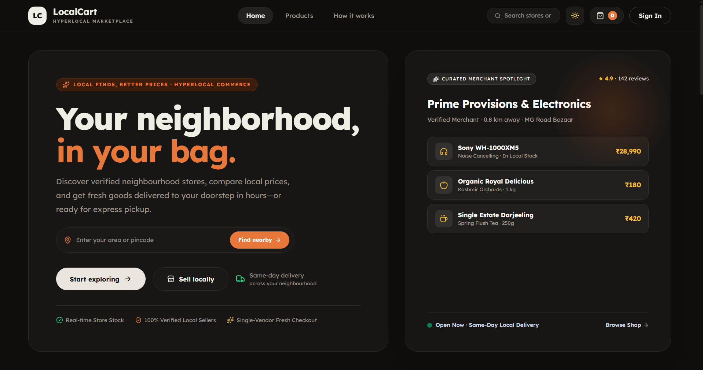
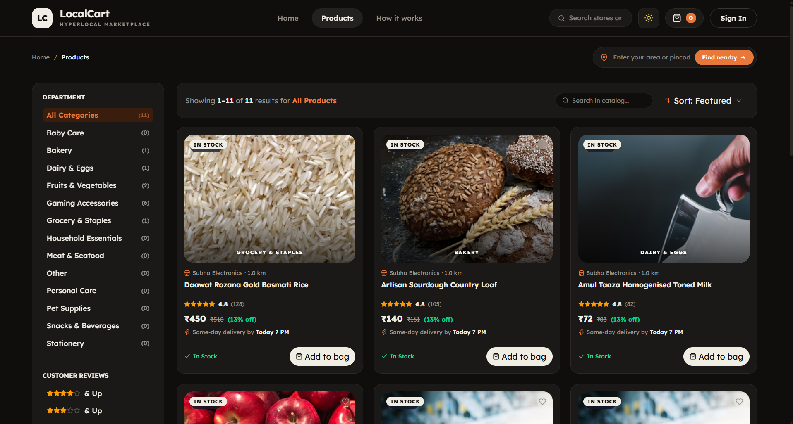
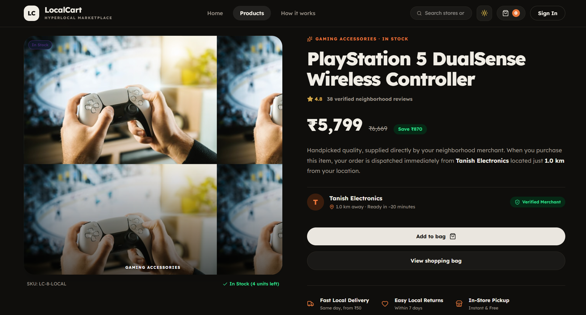
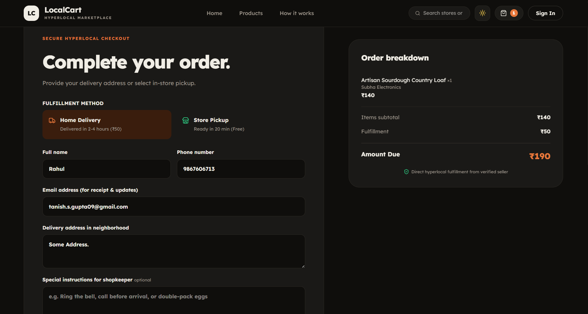
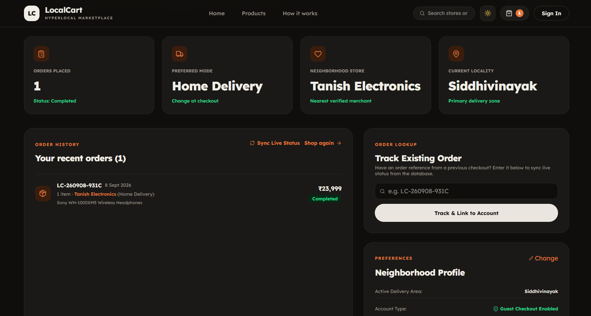
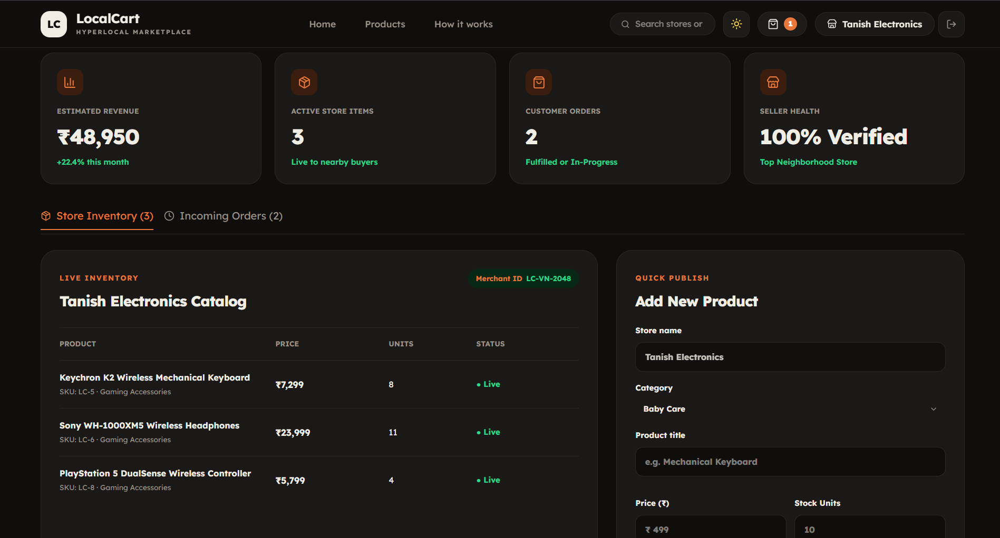

<p align="center">
  
</p>

> A boutique hyperlocal marketplace connecting neighborhood residents with verified local merchants for same-day delivery and express counter pickup.

[](https://dotnet.microsoft.com/)
[](https://reactjs.org/)
[](https://www.typescriptlang.org/)
[](https://tailwindcss.com/)
[](https://vitejs.dev/)
[](./LICENSE)

---

## Description

**LocalCart** bridges neighborhood brick-and-mortar stores with modern digital shoppers. Customers can discover nearby verified merchants, compare local prices, verify live stock, and choose between rapid doorstep delivery or express counter pickup.

### Core Principles

- **100% Login-Free Customer Journey**: Customers browse, build bags, and complete checkouts with zero forced account creation or password friction.
- **Dedicated Vendor Studio**: Local store owners manage live inventory, price adjustments, and customer order fulfillment queues through a dedicated merchant portal.
- **Platform Operations Center**: Centralized administration for monitoring real-time platform GMV, store network health, catalog SKU audits, and downloadable operational CSV reports.

---

## Features

### Customer Experience (100% Login-Free)

- **Hyperlocal Discovery**: Browse fresh produce, bakery, dairy, electronics, and daily staples from neighborhood stores.
- **Amazon-Grade 2-Column Catalog**:
  - Sticky department filter sidebar with live SKU counts.
  - Customer review filters (4.0★ & Up, 3.0★ & Up).
  - Price brackets (Under ₹500, ₹500–₹1,000, ₹1,000–₹3,000, Over ₹3,000).
  - Availability toggles (⚡ Same-Day Delivery, ✓ In-Stock Only).
  - Multi-criteria sorting (Featured, Customer Reviews, Price Low to High, Price High to Low).
- **Single-Vendor Cart Enforcement**: Guarantees fast, reliable single-point fulfillment and prevents multi-store logistics confusion.
- **Fast Guest Checkout**: Place orders in seconds with delivery preference (Home Delivery or Store Pickup) and address.
- **Live Order Tracking**: Instant tracking and live status updates (`Pending` $\to$ `Accepted` $\to$ `Ready for Pickup` $\to$ `Completed`) via public order reference lookup.
- **Active Locality Resolution**: Automatic detection and display of delivery neighborhood (e.g. _Siddhivinayak, Mumbai_) with an inline locality editor.
- **Luxury Boutique Design**: Typography powered by **Lexend**, custom warm palette, curved custom scrollbars, and luxury dropdown selects.

### Vendor Studio (`/vendor`)

- **Self-Service Merchant Onboarding (`/signup`)**: Store owners register their shop, owner details, contact information, and physical address in minutes.
- **Inventory Management**: Add new products, update selling prices, adjust live stock units, and identify low-inventory items.
- **Order Fulfillment Pipeline**: Real-time incoming customer order stream with step-by-step status transitions.
- **Cross-Dashboard Synchronization**: Vendor status updates immediately push across to customer dashboards in real time.

### Admin Operations Center (`/admin`)

- **100% Real Live Metrics**: Real-time calculations of Gross Merchandise Value (GMV), total order volume, active merchant network, and total catalog SKUs.
- **Tabbed Operations Views**:
  - **Products Oversight**: Live search across SKUs, low-stock warnings ($\le 5$ units), inline product price/stock editor modal, real product deletion, and catalog CSV export.
  - **Registered Merchants**: Complete directory of all registered stores with owner names, contact info, physical addresses, and active verification badges.
  - **Live Customer Orders**: Order audit stream with customer details, delivery mode, total amounts, and orders CSV export.
- **Dynamic Operational Alerts**: Real-time alerts generated directly from database conditions (low inventory items, pending dispatch orders, new store onboarding).
- **Client-Side CSV Exports**: Instant browser downloads for `localcart_catalog.csv`, `localcart_merchants.csv`, and `localcart_orders.csv`.

---

## Tech Stack

### Frontend

- **Framework**: [React 18](https://react.dev/) + [TypeScript](https://www.typescriptlang.org/)
- **Bundler & Tooling**: [Vite](https://vitejs.dev/)
- **Styling**: [Tailwind CSS v4](https://tailwindcss.com/) + Global CSS Custom Properties (Warm Luxury Palette)
- **Typography**: [Google Fonts Lexend](https://fonts.google.com/specimen/Lexend) & Lexend Deca
- **Icons**: [Lucide React](https://lucide.dev/)
- **Routing**: [React Router v7](https://reactrouter.com/)
- **State Management**: React Context API (`AuthContext`, `CartContext`, `OrderContext`, `ProductContext`, `ThemeContext`)
- **Persistence**: Hybrid `localStorage` / `sessionStorage` with live backend synchronization

### Backend

- **Framework**: [ASP.NET Core Web API](https://dotnet.microsoft.com/) (.NET 10.0)
- **ORM**: [Entity Framework Core 10](https://learn.microsoft.com/en-us/ef/core/)
- **Database**: Microsoft SQL Server
- **Security & Cryptography**:
  - Native .NET PBKDF2 with SHA-256 (`Rfc2898DeriveBytes.Pbkdf2`)
  - 100,000 iteration rounds with 128-bit cryptographic salt
  - Constant-time comparison (`CryptographicOperations.FixedTimeEquals`) to prevent timing attacks
- **Authentication**: JWT Bearer Token (`Microsoft.AspNetCore.Authentication.JwtBearer`)
- **Documentation**: OpenAPI / Swagger (`Microsoft.AspNetCore.OpenApi`, `Microsoft.OpenApi`)

---

## Project Structure

```
LOCAL-CART/
├── Backend/
│   └── LocalCart.Api/                      # ASP.NET Core 10 Web API
│       ├── Controllers/                    # REST API Controllers (Auth, Products, Categories, Vendors, Orders)
│       ├── Data/                           # EF Core DbContext, Entity Configurations & Migrations
│       ├── DTOs/                           # Data Transfer Objects (Auth, Products, Vendors, Orders)
│       ├── Entities/                       # Database Entities (AppUser, Vendor, Product, Order, etc.)
│       ├── Exceptions/                     # Custom Domain Exceptions & Error Payloads
│       ├── Interfaces/                     # Service & Repository Contract Definitions
│       ├── Middleware/                     # Global Exception Handling & Logging Pipeline
│       ├── Repositories/                   # EF Core Data Access Repositories
│       ├── Services/                       # Business Logic (Auth, PasswordHasher, Token, Product, Vendor, Order)
│       ├── Program.cs                      # Dependency Injection, Middleware Pipeline & CORS
│       └── appsettings.json                # Database Connection Strings & JWT Config
│
├── Frontend/
│   └── LocalCart-Web/                      # React 18 + TypeScript + Vite Application
│       ├── public/                         # Static Assets & Icons
│       ├── src/
│       │   ├── components/                 # Modular Reusable UI Components
│       │   │   ├── auth/                   # Route Guards (RequireAccess)
│       │   │   ├── cart/                   # CartItemRow, OrderSummary, Bag Counter
│       │   │   ├── common/                 # CustomSelect, MetricCard, LocationBar, ScrollToTop
│       │   │   ├── layout/                 # Header (Clean 3-Link Nav), Footer, PanelShell
│       │   │   └── product/                # ProductCard (Amazon Grade), ProductArtwork
│       │   ├── context/                    # Global Context Providers (Auth, Cart, Order, Product, Theme)
│       │   ├── pages/                      # Page Components & Workspaces
│       │   │   ├── HomePage.tsx            # Hero, Merchant Showcase & Value Strips
│       │   │   ├── ProductsPage.tsx        # Amazon-Style 2-Column Catalog & Sidebar
│       │   │   ├── ProductDetailPage.tsx   # High-Res Product Details & Specifications
│       │   │   ├── CartPage.tsx            # Shopping Bag & Single-Vendor Order Review
│       │   │   ├── CheckoutPage.tsx        # Fast Guest Checkout & Delivery Form
│       │   │   ├── OrderConfirmedPage.tsx  # Order Confirmation Ticket & Summary
│       │   │   ├── CustomerDashboardPage.tsx # Live Order Tracking & Locality Preferences
│       │   │   ├── LoginPage.tsx           # Unified Sign-In Portal (Vendor & Admin)
│       │   │   ├── SignUpPage.tsx          # Dedicated Vendor Self-Registration Form
│       │   │   ├── VendorDashboardPage.tsx # Merchant Studio & Fulfillment Queue
│       │   │   ├── AdminDashboardPage.tsx  # Platform Operations, Directory & CSV Exports
│       │   │   ├── HowItWorksPage.tsx      # Customer & Vendor Guide
│       │   │   └── NotFoundPage.tsx        # Custom 404 Error Page
│       │   ├── routes/                     # React Router Configuration (AppRoutes)
│       │   ├── services/                   # HTTP Client & API Modules (apiClient, authApi, etc.)
│       │   ├── types/                      # TypeScript DTOs & Domain Models
│       │   ├── utils/                      # Currency (₹) & Date Formatters
│       │   ├── styles.css                  # Global Luxury Styles & CSS Variable Tokens
│       │   ├── App.tsx                     # Top-Level App Shell
│       │   └── main.tsx                    # React Entrypoint
│       ├── index.html                      # HTML5 Shell & Lexend Google Fonts
│       ├── vite.config.ts                  # Vite Build Configuration
│       └── package.json                    # Dependencies & Scripts
│
├── fix-git-index.ps1                       # Automated Git Index Self-Healing Utility
├── Memory.md                               # Project Memory & Technical Roadmap
├── README.md                               # Project Documentation
└── LICENSE                                 # MIT Open-Source License
```

---

## Prerequisites

Before running the project locally, ensure you have the following installed:

- **.NET 10 SDK** (or .NET 9+): [Download .NET](https://dotnet.microsoft.com/download)
- **Node.js (v18 or higher)** & **npm (v9+)**: [Download Node.js](https://nodejs.org/)
- **Microsoft SQL Server**: LocalDB, SQL Server Express, or Azure SQL
- **PowerShell** (Windows) or **Bash** (macOS/Linux)

---

## Getting Started

### 1. Clone the Repository

```bash
git clone https://github.com/kaifshaikh786/LOCAL-CART.git
cd LOCAL-CART
```

### 2. Backend Setup (.NET 10 Web API)

1. Navigate to the API directory:

   ```bash
   cd Backend/LocalCart.Api
   ```

2. Configure your database connection in `appsettings.json` (or via .NET User Secrets):

   ```json
   {
     "ConnectionStrings": {
       "DefaultConnection": "Server=(localdb)\\mssqllocaldb;Database=LocalCartDb;Trusted_Connection=True;MultipleActiveResultSets=true;TrustServerCertificate=True"
     }
   }
   ```

3. Restore dependencies, apply database migrations, and run:

   ```bash
   dotnet restore
   dotnet run
   ```

   The backend API will start at:
   - **Base URL**: `http://localhost:5168`
   - **OpenAPI / Swagger**: `http://localhost:5168/swagger`

---

### 3. Frontend Setup (React + Vite)

1. Open a new terminal and navigate to the frontend directory:

   ```bash
   cd Frontend/LocalCart-Web
   ```

2. Install npm dependencies:

   ```bash
   npm install
   ```

3. Start the development server:

   ```bash
   npm run dev
   ```

4. Open your browser and navigate to:
   **`http://localhost:5173`**

---

## 🔌 API Endpoints

The API is structured with clean role-based boundaries and non-authenticated guest access:

### 1. Public & Customer Endpoints (No Authentication Required)

| Method | Endpoint                       | Description                                                              |
| ------ | ------------------------------ | ------------------------------------------------------------------------ |
| `POST` | `/auth/login`                  | Authenticate vendor/admin with email & password (returns JWT).           |
| `POST` | `/auth/register`               | Optional customer registration.                                          |
| `POST` | `/auth/register-vendor`        | Public vendor store onboarding and registration.                         |
| `GET`  | `/products`                    | List catalog products (filters: `vendorId`, `categoryId`, `search`).     |
| `GET`  | `/products/{id}`               | Get product details by ID.                                               |
| `GET`  | `/product-categories`          | List active product categories/departments.                              |
| `GET`  | `/vendors`                     | List verified active local merchants.                                    |
| `GET`  | `/vendors/{id}`                | Get public store details by vendor ID.                                   |
| `POST` | `/orders`                      | Place a customer order (Guest or authenticated, single-vendor enforced). |
| `GET`  | `/orders/lookup/{orderNumber}` | Public real-time tracking lookup for an order reference.                 |

---

### 2. Customer Endpoints (Authenticated: `Role: Customer`)

| Method | Endpoint   | Description                                          |
| ------ | ---------- | ---------------------------------------------------- |
| `GET`  | `/auth/me` | Get authenticated customer profile and user details. |

---

### 3. Vendor Endpoints (Authenticated: `Role: Vendor, Admin`)

| Method   | Endpoint                | Description                                                                   |
| -------- | ----------------------- | ----------------------------------------------------------------------------- |
| `GET`    | `/products/my-products` | Retrieve all products listed by the authenticated vendor.                     |
| `POST`   | `/products`             | Publish a new product to the vendor's catalog.                                |
| `PUT`    | `/products/{id}`        | Update product pricing, description, or stock units.                          |
| `DELETE` | `/products/{id}`        | Remove or deactivate a product listing.                                       |
| `GET`    | `/orders/my-orders`     | Fetch incoming customer orders for the vendor store.                          |
| `PUT`    | `/orders/{id}/status`   | Update order status (`Accepted`, `ReadyForPickup`, `Completed`, `Cancelled`). |

---

### 4. Admin Operations Endpoints (Authenticated: `Role: Admin`)

| Method   | Endpoint                        | Description                                                         |
| -------- | ------------------------------- | ------------------------------------------------------------------- |
| `GET`    | `/vendors?includeInactive=true` | Audit all registered stores (both active and pending verification). |
| `POST`   | `/vendors`                      | Provision a new vendor store directly.                              |
| `PUT`    | `/vendors/{id}`                 | Modify vendor credentials, verification, or address.                |
| `DELETE` | `/vendors/{id}`                 | Deactivate or remove a store from the platform.                     |
| `POST`   | `/product-categories`           | Create a new platform product category.                             |
| `PUT`    | `/product-categories/{id}`      | Edit an existing category.                                          |
| `DELETE` | `/product-categories/{id}`      | Delete a product category.                                          |
| `DELETE` | `/products/{id}`                | Force-delete any violating product across the entire platform.      |
| `GET`    | `/orders/{id}`                  | Access comprehensive order details across all stores.               |

---

## Screenshots

|       Home & Merchant Showcase       |                 Product Catalog                 |
| :----------------------------------: | :---------------------------------------------: |
|  |  |

|       Single-Vendor Cart & Bag       |             Rapid Guest Checkout             |
| :----------------------------------: | :------------------------------------------: |
|  |  |

|               Customer Dashboard & Live Sync                |             Vendor Studio Fulfillment Queue             |
| :---------------------------------------------------------: | :-----------------------------------------------------: |
|  |  |

---

## Future Improvements

- [ ] **Payment Gateway Integration**: Integration of Razorpay, Cashfree, or UPI QR codes for digital payments at checkout.
- [ ] **Vendor Image File Uploads**: Direct multipart image upload support saving files to local static storage or AWS S3 / Cloudinary.
- [ ] **Real-Time Push Notifications**: ASP.NET Core SignalR WebSocket hub for instantaneous status updates on customer screens.
- [ ] **Customer Reviews & Ratings Submission**: Post-delivery review modal with star ratings and comments.
- [ ] **Live Geolocation & Distance Calculation**: Browser Geolocation API integration with OpenStreetMap / Google Maps for real walking distance filters (e.g. _0.8 km away_).
- [ ] **Store Hours & Operating Toggle**: Vendor toggle for "Open for Orders" vs. "Temporarily Closed" with automatic schedule enforcement.
- [ ] **Automated PDF Invoice Generation**: Downloadable GST-compliant order receipts.
- [ ] **Dockerization & CI/CD**: Multi-stage `Dockerfile` and GitHub Actions deployment pipeline.

---

## Author

- **Tanish Gupta**
  - GitHub: [@Tanish15-gif](https://github.com/Tanish15-gif)
  - GitHub: [@kaifshaikh786](https://github.com/kaifshaikh786)
  - GitHub: [@samadshaikh0007866-a11y](https://github.com/samadshaikh0007866-a11y)

---

## License

This project is open-source and licensed under the [MIT License](./LICENSE).
